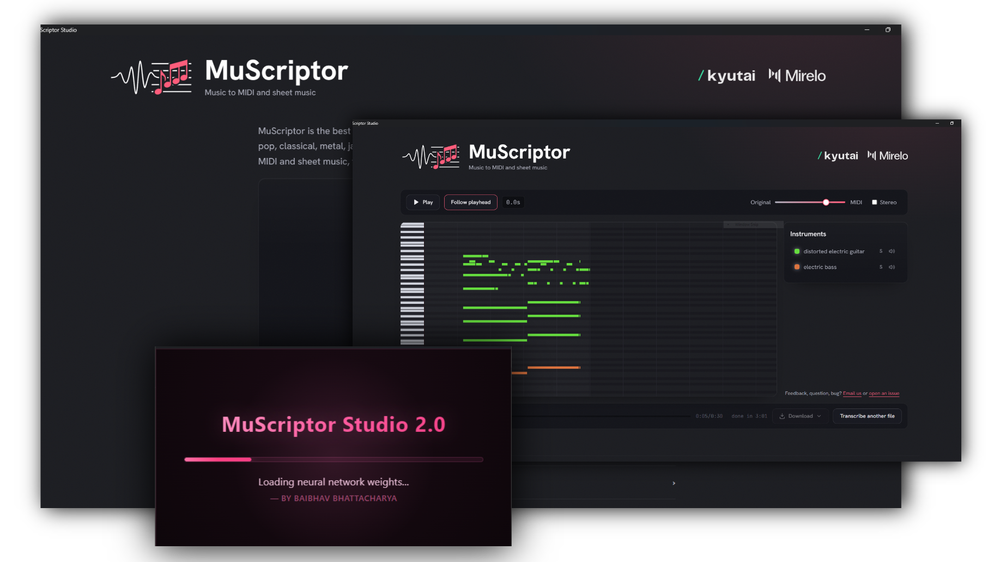

# Local MuScriptor
Local MuScriptor or MuScriptor Studio is a completely offline and zero dependency wrapper around MuScriptor. It bundles the MuScriptor Medium Model and its WebUI in a zero dependency two click installer for completely offline operation.  
It supports exporting .midi files and all the time stretching options however, exporting as a transcribed wave or sheet music has not been implemented and there are no plans for it till now.  

This software is free for anybody to use and download , however distribution, resale and modifications to the software are strictly prohibited. Any integrated libraries and open source components retain their original licenses , the above terms only apply to the MuScriptor Local Wrapper, for more information view [LICENSE](LICENSE)

# Local MuScriptor & WebUI

# Instructions

1. Download *local-muscriptor-release2-0-setup.rar* from the here.  
2. Extract the rar file using WinRaR or 7Zip  
3. Install the included *MuScriptor_Studio_Setup_x64  
4. The app should be installed with a shortcut on your desktop.  

**NOTE : Local MuScriptor is only availabe for Windows 10/11**  

# Credits
The Local MuScriptor wrapper has been developed by **Baibhav Bhattacharya**.  
Check out [MuScriptor](https://github.com/muscriptor/muscriptor)  
Check out [Huggingface](https://huggingface.co/MuScriptor/muscriptor-medium)
