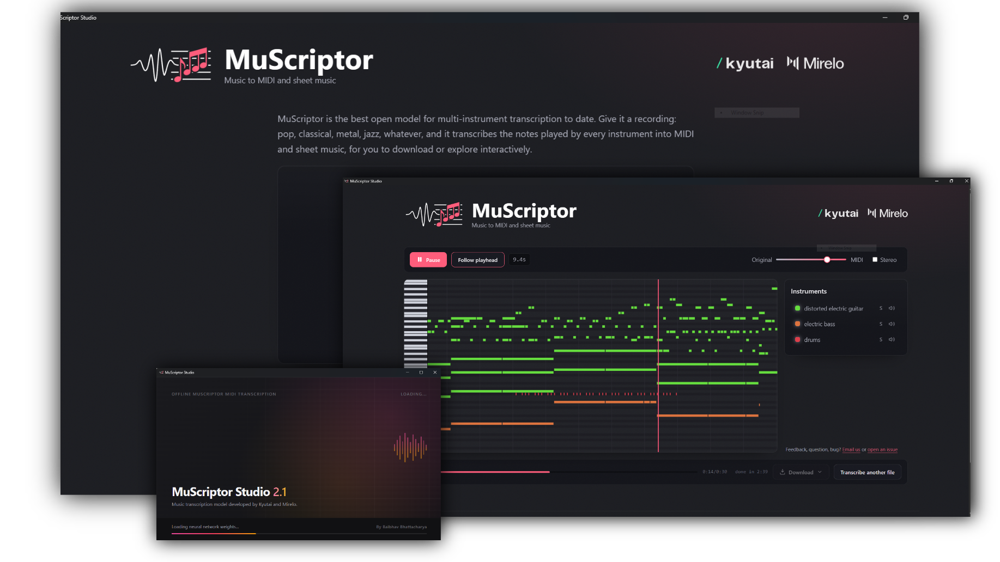
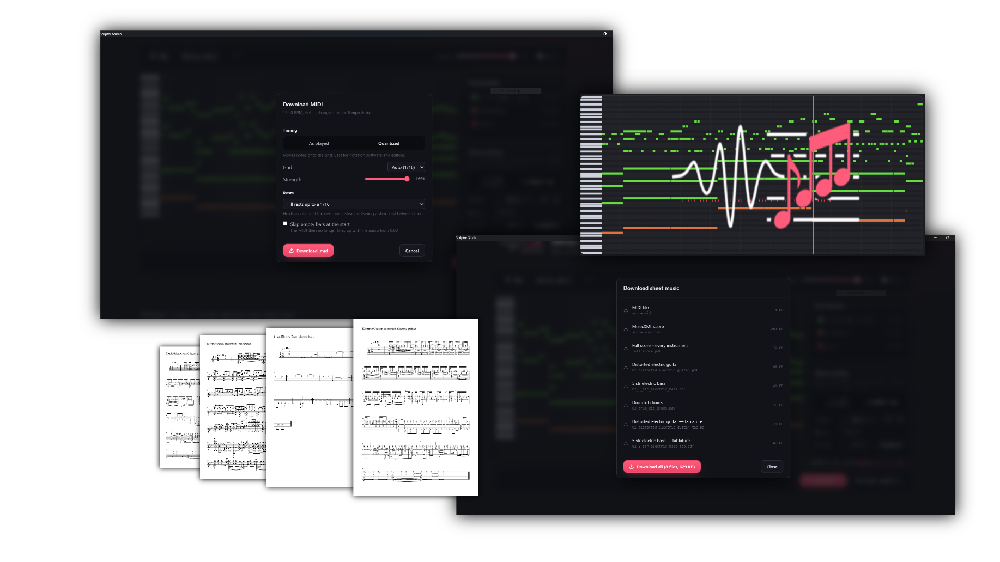

# Local MuScriptor
Local MuScriptor or MuScriptor Studio 2.1 is a completely offline and zero dependency wrapper around MuScriptor. It bundles the MuScriptor Medium Model and its WebUI in a zero dependency two click installer for completely offline operation.  
It supports exporting .midi files and all the time stretching options however, exporting as a transcribed wave or sheet music has not been implemented and there are no plans for it till now.  

Local MuScriptor or MuScriptor Studio is named such due to its completely offline nature and strict usage of the CPU instead of relying on GPU & CUDA in consideration of Studio Workstations which may not have NVIDIA Graphics Cards due to DPC Latency issues.  

This software is free for anybody to use and download , however distribution, resale and modifications to the software are strictly prohibited. Any integrated libraries and open source components retain their original licenses , the above terms only apply to the MuScriptor Local Wrapper, for more information view [LICENSE](LICENSE)

# Local MuScriptor & WebUI

---

# What's new in MuScriptor 2.1

## New Features  & Bug Fixes in MuScriptor Studio 2.1

- Export as wave.
- MIDI Playback.
- Transcribe to Sheet music.
- MuseScore & FluidSynth Integration.
- New Splash Ui.
- Bug fixes and modification to muscriptor for offline use even when the computer is connected to the internet.
- Removed dependency on premade cache directories.

---

# Download Instructions

**Uninstall any previous installations of *MuScriptor Studio 2.0* from windows settings, before installing the latest version *MuScriptor Studio 2.1*.**

1. Download *local-muscriptor-release2-1-setup.rar* from [Google Drive](https://drive.google.com/file/d/1xgSE_NIIhYyk2pX6wTl62NEgSFhuuv_Y/view?usp=drive_link)  
2. Extract the rar file using WinRaR or 7Zip  
3. Install the included *MuScriptor_Studio_2_1_Setup_x64.exe*   
4. The app should be installed with a shortcut on your desktop.  

**NOTE : Local MuScriptor is only available for Windows 10/11**  
*The installer is available on Google Drive because it is ~3.86 GB in size and such large files cannot be directly hosted on Github*

---
# Minimum System Requirements

- Windows 10/11 &mdash; 64 Bit Only
- Quad Core Intel or AMD Processor with minimum 1.8Ghz clock speed
- 8GB System Memory (16 GB Recommended)
- 8GB Hard Disk Space
---
# Credits
The Local MuScriptor wrapper has been developed by **Baibhav Bhattacharya**.  
Check out [MuScriptor](https://github.com/muscriptor/muscriptor)  
Check out [Huggingface](https://huggingface.co/MuScriptor/muscriptor-medium)
